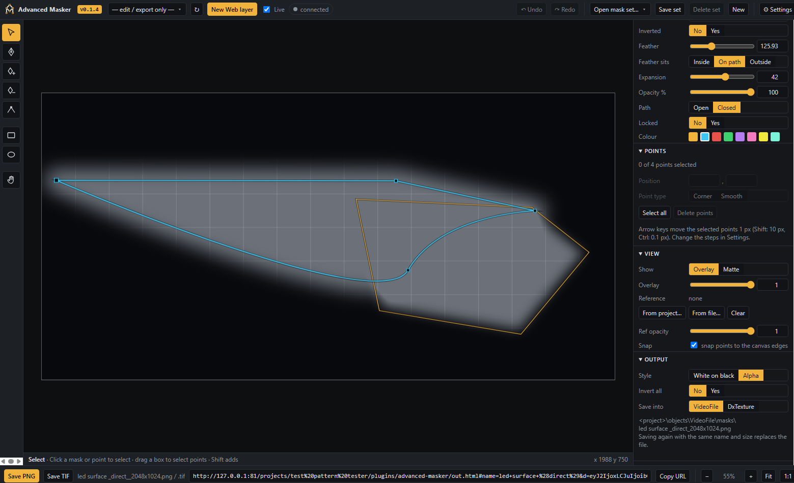

# Advanced Masker — disguise Designer plugin

Draw masks with a pen tool inside Designer, stack them as layers you can turn on and off, size the
canvas from a mapping, show the result live on a Web layer, and save it as a PNG or TIF into the
project's `objects/VideoFile` or `objects/DxTexture` folder.



## Install

```
python build.py --install "<Designer project>\plugins"
```

Then in Designer: **Plugins → Plugin Launcher → Advanced Masker**. After an update, close the plugin
window and open it again.

## Using it

- **Canvas**: name and size in pixels. *Size from mapping…* lists the project's mappings with their
  sizes (and a few common sizes). New Web layers get that mapping.
- **Mask layers**: the eye turns a mask on or off, the lock stops it being edited on the canvas.
  Masks combine from the top of the list down. Double-click a name to rename it.
- **Tools** (left bar):
  - *Select*: click a point, a line or inside a mask; drag a box to select points; Shift adds.
    Drag points, handles or a whole mask.
  - *Pen*: click for a corner point, drag for a curve; click the first point (or double-click) to
    close. Over a line of the selected mask it adds a point, over a point it removes it.
  - *Add point* / *Delete point*: click a line / a point.
  - *Convert point*: click a point to switch corner and smooth, drag from a point to pull new
    handles, drag one handle to move it on its own.
  - *Rectangle* / *Ellipse*: drag to draw a closed mask (Shift for a square or circle).
  - *Hand*: move the view. The wheel zooms; the middle or right mouse button pans with any tool.
- **Arrow keys** move the selected points 1 px (Shift: 10 px, Ctrl: 0.1 px). There are no other
  shortcuts: Undo, Redo, Delete and the rest are buttons.
- **Panel values**: drag a slider with Shift for coarse steps or Ctrl to move slowly in fine steps;
  in a number box Up / Down step the value (Shift ×10, Ctrl ×0.1).
- **Settings** (top right): the arrow-key steps, the Shift / Ctrl multipliers for values, and how long
  the pointer rests on a control before its tooltip shows (0 turns tooltips off).
- **Selected mask**: mode (Add, Subtract, Intersect, Lighten, Darken, Difference, None), Inverted,
  Feather (edge softness) and where it sits (Inside the path, On the path, Outside the path), Expansion (grow or shrink the edge), Opacity,
  Open / Closed path, Locked, outline colour.
- **View**: Overlay (a reference picture with the cut-away area darkened) or Matte (the output).
  The reference picture comes from the project's image folders or a file, and is never exported.
- **Output**: White on black, or white with Alpha; Invert all; where Save PNG / Save TIF write.
  Files are named `<name>_<width>x<height>.png` and saving again replaces the file.
- **Mask sets**: *Save set* writes `<plugin>/masks/<name>.json`; *Open mask set…* loads one.

## Development

```
src/mask.js          mask model + renderer (global AMask), shared by the window, out.html and exports
src/index.src.html   plugin window; build inlines mask.js and designer.py
src/out.src.html     page a Web layer loads; the mask set is in the URL hash (#name=…&d=…)
src/designer.py      Python 2.7 helper that runs inside Designer (also shipped as __init__.py)
tests/               fake Designer (mock_designer.py) + Playwright end-to-end test
```

Tests: `npm install`, `npx playwright install chromium` once, then `python tests/run_tests.py`.

## Licence

MIT, see [LICENSE](LICENSE).
